<a href="https://github.com/eBlackrose/weekly-report">
  <picture>
    <source media="(prefers-color-scheme: dark)" srcset="https://eblackrose.github.io/weekly-report/card-dark.svg" />
    <source media="(prefers-color-scheme: light)" srcset="https://eblackrose.github.io/weekly-report/card.svg" />
    
  </picture>
</a>

 
<!-- Enable once you are ranked on committers.top (United States):

-->

- A senior AI engineer & full stack developer
- TypeScript, Python, Kotlin, Dart, Swift, Rust
- Web, Mobile, GenAI, LLM agents, Computer Vision, Cloud, Everything to solve real-world problems
- org: [@CLEVIO-LLC](https://github.com/CLEVIO-LLC)
- [blog](https://ronniekim.io) · [Weekly Report](https://eblackrose.github.io/weekly-report/) · [LinkedIn](https://linkedin.com/in/imronnie)

> [!NOTE]
> This is just my personal account, so you'll find some personal projects and experiments here.

<!-- featured:start -->
## Featured Projects

  <a href="https://github.com/eBlackrose/Flutter-Whatsapp-bot">
    <picture>
      <source media="(prefers-color-scheme: dark)" srcset="./showcase-Flutter-Whatsapp-bot-dark.svg" />
      <source media="(prefers-color-scheme: light)" srcset="./showcase-Flutter-Whatsapp-bot.svg" />
      
    </picture>
  </a>
  <a href="https://github.com/eBlackrose/Claude-Think">
    <picture>
      <source media="(prefers-color-scheme: dark)" srcset="./showcase-Claude-Think-dark.svg" />
      <source media="(prefers-color-scheme: light)" srcset="./showcase-Claude-Think.svg" />
      
    </picture>
  </a>
  <a href="https://github.com/eBlackrose/ReactNative-Chatgpt">
    <picture>
      <source media="(prefers-color-scheme: dark)" srcset="./showcase-ReactNative-Chatgpt-dark.svg" />
      <source media="(prefers-color-scheme: light)" srcset="./showcase-ReactNative-Chatgpt.svg" />
      
    </picture>
  </a>
  <a href="https://github.com/eBlackrose/Open-Cuak">
    <picture>
      <source media="(prefers-color-scheme: dark)" srcset="./showcase-Open-Cuak-dark.svg" />
      <source media="(prefers-color-scheme: light)" srcset="./showcase-Open-Cuak.svg" />
      
    </picture>
  </a>

  <a href="https://github.com/eBlackrose?tab=repositories">See more →</a>

<!-- featured:end -->
